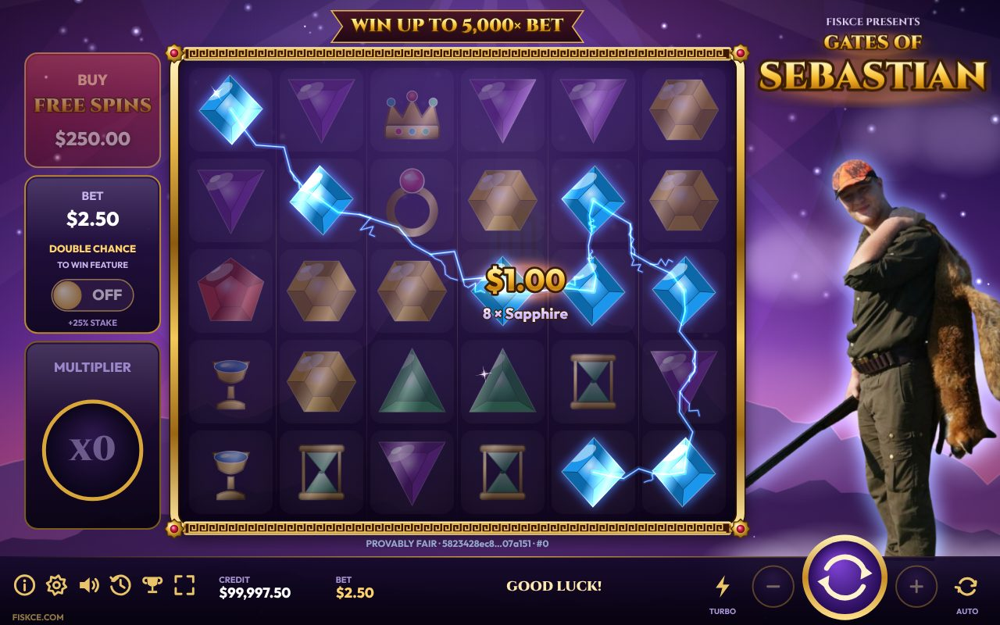
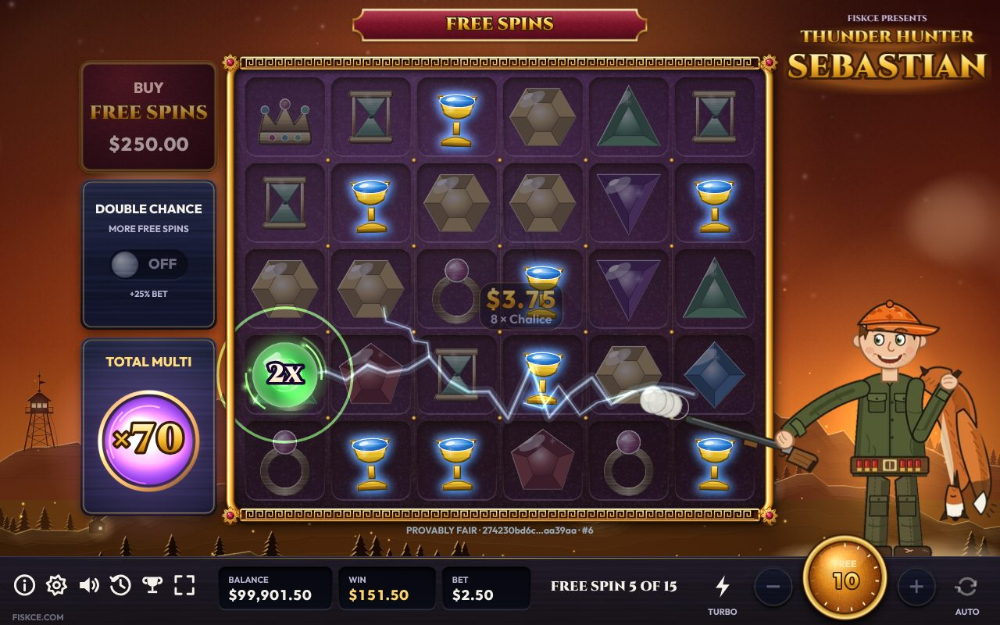
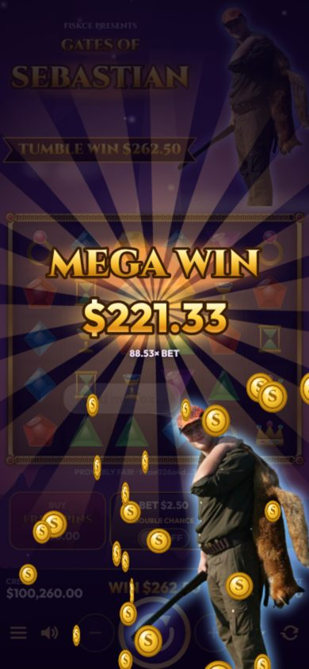

# Gates of Sebastian ⚡

A Gates of Olympus–style tumbling slot (v8). The game opens with the "Only on Stake" sting. Sebastian stands on a cloud above Olympus and fires multiplier orbs from his shotgun. Everything is drawn on a single HTML5 canvas, with no build step and no dependencies. It installs as an app and plays offline.





## Play

Serve the folder and open it in a browser:

```bash
python3 -m http.server 8000      # then visit http://localhost:8000
```

Opening `index.html` straight from disk also works, but the browser then blocks the fonts and sound files, so you get fallback fonts and synthesized sound. Offline/install support also needs it to be served (https or localhost).

**Controls:** Space or Enter spins. Press Space again, or tap the board, to hurry a spin. ↑/↓ change the bet, T toggles turbo, M mutes and I opens the rules. Taps skip win celebrations.

## What's new in v8

Presentation only: the payout math is byte-for-byte the v7 engine (`tools/test.js` pins it with a fingerprint of 5,000 spins).

**A living board and camera**
- Gems breathe: light sweeps across them, now and then one turns over in 3D, and a glint runs diagonally across every freshly landed board.
- **Lightning chains** link every symbol of a winning cluster. When they shatter, their sparks **stream into the TUMBLE WIN plaque**, which counts up as each one lands.
- During a scatter tease the **camera pushes in** on each held column, the world darkens and a heartbeat takes over the music.
- **Slow motion** when a 100×+ orb lands and when the scatter that completes a trigger drops.
- **Phone tilt** (opt-in in Settings): the board and sky shift against each other as you tilt your phone.

**Sebastian comes alive**
- He **turns to aim** at the cell before he fires, leans in during teases, wiggles his head on a near miss and **jumps** at every big-win tier.
- On big wins he **slides in over the celebration**; in free spins his **eyes glow**.
- **Speech bubbles** ("Bullseye!", "Hold my fox…", "So close…"), rate-limited so he never nags. None of them suggest a win is due.

**Bigger free spins**
- The **storm grows with the total multiplier**: more lightning, a crimson sky, faster clouds, slanting rain and a low rumble.
- **Milestones** at ×25, ×50, ×100, ×250 and ×500 total multiplier get their own headline, thunder and a quip.
- **Adaptive music**: a drum layer under the soundtrack that is silent at rest, pulses while the reels spin, builds with every cascade and drives free spins.

**Polish and reach**
- **Installable and offline** (PWA): add it to a home screen and it runs without a connection.
- **Adaptive quality**: it measures its own frame time and trims effects, particles and resolution on weak devices (and steps back up when there's headroom). Settings: Auto / High / Medium / Low.
- **Stats and achievements**: session and all-time stats, 13 achievements with toasts (the trophy icon).
- **Vibration** on big moments (Android), plus settings for dynamic music, phone tilt and reduced motion (which also turns off shake, zoom, push-in, tilt and flips).
- Lightning and flashes are capped at 3 strong flashes per second (WCAG 2.3.1).

## v7: the rebuild from v6

**Look and feel**
- A painted world: an Olympus skyline with golden gates on the summit, nebula, twinkling stars, drifting clouds, a slowly turning light fan and random sky lightning. It's pre-rendered per resize and cross-fades from **violet dusk** in the base game to a **golden storm** in free spins.
- An ornate board: a gold frame with Greek-key lintels and ruby rosettes, glass slots and column dividers.
- Real fonts (Cinzel and Outfit, bundled) and vector icons instead of emoji, so it looks the same on every OS.
- Layouts for desktop, ultrawide, tablet and phone in both orientations. Portrait gives spare height to Sebastian and the logo.

**More dynamic play**
- **Column-by-column reel stops.** When enough scatters are showing to tease a feature, the remaining columns are held back. They spin with motion blur under a golden light while a suspense riser plays and the music muffles.
- **Squash and stretch** when symbols land, with a dust puff and a thud per column. Each landed scatter rings higher in pitch.
- **Wins:** non-winners dim, winners pulse and glow, and each cluster gets a floating "$2.50 / 8 × Amethyst" label. Winners then **shatter into shards** in their own colour. Win chimes climb with every cascade.
- **Multiplier orbs** come in four colour tiers. Sebastian fires each one as a forked lightning bolt from his shotgun barrel, with recoil and a muzzle flash. The orb lands with a shockwave and then **flies into the multiplier collector**. When the tumbling stops, the collector's value **slams** into the win, with a screen shake, a zoom punch and a count-up.
- **Big wins** count up through **Big → Mega → Epic → Legendary → Max** with rays, a coin fountain and music ducking. A tap skips to the total.
- **Free spins** get an intro and an outro, a persistent TOTAL MULTI that the orbs keep charging, retrigger banners, and a spin counter on the spin button.
- **Turbo**, **slam-stop**, **autoplay** (10/25/50/100/∞) and a buy-feature confirmation.

**Under the hood**
- All animation waits run on a **game clock**. Turbo and slam-stop simply speed the clock up, and a hidden tab freezes everything together.
- Particles are pooled, drawn from cached sprites and advanced with the real frame delta, so they look the same at 30, 60 or 144 Hz. v6 tied them to 60 fps.
- Credit, bet and settings persist in `localStorage`. There is a "Reset demo balance" button, and a reduce-motion setting that defaults from `prefers-reduced-motion`.
- The **5,000× max win** is enforced across the whole round, including the feature. v6 only capped single spins.

## The math, honestly measured

v6's README claimed 96.5% RTP. Simulating its engine gave a different picture. Its **Ante mode returned ~106%**, paying more than it cost, and **Buy Free Spins returned ~89%**. v7 fixes both. The feature now uses its own scatter rate, so it is worth the same however you reach it. The scatter and orb rates were then re-tuned with `tools/sim.js`, which measures RTP in parts: `RTP = (base-spin return + trigger rate × feature value) / stake`. That gives far tighter numbers than raw full rounds of a very volatile game.

From 16 million base spins and 800,000 features (`node tools/sim.js --spins 1.6e7 --features 8e5`):

| | v7 |
|---|---|
| RTP, base game | **96.67% ± 0.27** |
| RTP, Double Chance (1.25× stake) | **96.56% ± 0.26** |
| RTP, Buy Free Spins (100× stake) | **96.35% ± 0.24** |
| Hit frequency | 25.6% |
| Free spins trigger | 1 in 273 (1 in 157 with ante, 1.74×) |
| Average feature | 96.2× bet, 17.6 spins (0.52 retriggers per feature) |
| Feature spread | 35% under 20× · 16% 100–250× · 0.9% over 1,000× |
| Volatility (σ per round) | 17.5× bet |
| Max win | 5,000× (1 in ~7,000 features) |

The browser and the simulator call the same `Engine.evaluate()`, so the payout on screen is exactly what was measured.

## Provably fair

Each spin draws its randomness from `HMAC-SHA256(serverSeed, "clientSeed:nonce:cursor")`. The SHA-256 hash of the server seed is shown under the board **before** you play. In the history panel (the clock icon), **Rotate seed** reveals the old seed, and **Verify** re-derives any spin played on it in the browser. It checks the hash, the exact starting board and the payout. You can set your own client seed too. `tools/test.js` checks the built-in SHA-256 and HMAC against Node's `crypto`.

## Game rules

- **Pay anywhere:** 8+ of a symbol anywhere on the 6×5 grid pays. Tiers are 8–9, 10–11 and 12+.
- **Tumble:** winners are removed, the rest fall and new symbols drop in. This repeats while wins keep forming.
- **Multiplier orbs:** 2, 3, 4, 5, 6, 8, 10, 25, 50, 100, 250 or 500×. In the base game, the orbs from one spin add up and multiply that spin.
- **Free spins:** 4+ scatters award 15 spins. Every orb is saved into a total multiplier that applies to each winning spin. 3+ scatters in the feature add +5.
- **Double Chance:** +25% stake for 1.74× the natural trigger rate. **Buy:** 100× bet, with ante off.

## Customising

| What | Where |
|---|---|
| Symbol art | Replace PNGs in `assets/symbols/` (keep the names), or edit `SYMBOL_IMAGES` in `js/board.js`. Use `''` for the built-in vector gem. |
| Sebastian | Replace `assets/sebastian.png` with a tall image on a transparent background. It's auto-cropped, and the bolts fire from the left-most opaque pixel, his gun barrel. The eye and head anchors (`EYES`, `HEAD` in `js/sebastian.js`) are measured on the original photo; with a different-sized image the eye glow switches itself off. |
| Quips | `LINES` in `js/sebastian.js`. |
| Achievements | `ACH` in `js/stats.js`. |
| Offline cache | `CORE` in `sw.js`; bump `VERSION` on every release. `node tools/test.js` fails if a file the game loads is missing from it. |
| Sounds | `SOUND_FILES` in `js/audio.js`. Leave `''` to use the synthesized sound. Every other effect is synthesized. |
| Math | `CONFIG` in `js/engine.js`. Re-run `node tools/sim.js` after any change. |

## Files

| File | Purpose |
|---|---|
| `js/engine.js` | Pure game math (no DOM): board, tumbles, orbs, evaluate, feature, round. Runs in Node too. |
| `js/fair.js` | Provably-fair commit/reveal RNG with a built-in SHA-256 and HMAC |
| `js/core.js` | Namespace, game clock (turbo, slow-mo), adaptive quality, easing, formatting, persistence, responsive layout |
| `js/scene.js` | The world behind the board, in two moods |
| `js/board.js` | Sprites, tumble physics, frame, anticipation columns, orbs |
| `js/fx.js` | Particles, lightning, floating text; camera shake, zoom, push-in, tilt; flash limiter |
| `js/sebastian.js` | Sebastian: pose (aim, lean, jump, recoil), eye glow, speech bubbles, big-win cut-in |
| `js/hud.js` | Side panels, logo, plaque, bottom bar, vector icons, hit regions |
| `js/overlays.js` | Big win, free-spins intro and outro, banners, milestones, multiplier slam |
| `js/stats.js` | Session and all-time stats, achievements, toasts |
| `js/game.js` | Spin orchestration, camera, input, render loop, boot, service-worker registration |
| `js/ui.js` | DOM panels: rules and paytable, settings, fairness and history, stats, buy, menu |
| `js/audio.js` | Web Audio engine: files plus synth, pitch, ducking, suspense filter |
| `js/music.js` | Adaptive drum layer and heartbeat under the soundtrack |
| `sw.js`, `manifest.json` | Offline cache and install metadata |
| `tools/sim.js` | Multi-threaded RTP simulator |
| `tools/test.js` | Crypto, determinism, engine invariants, math fingerprint, offline-cache coverage |

> For entertainment only. Demo credits, no real-money gambling.

Fonts: Cinzel and Outfit, SIL Open Font License (`assets/fonts/OFL.txt`). Code: GPL-3.0 (`LICENSE`).
